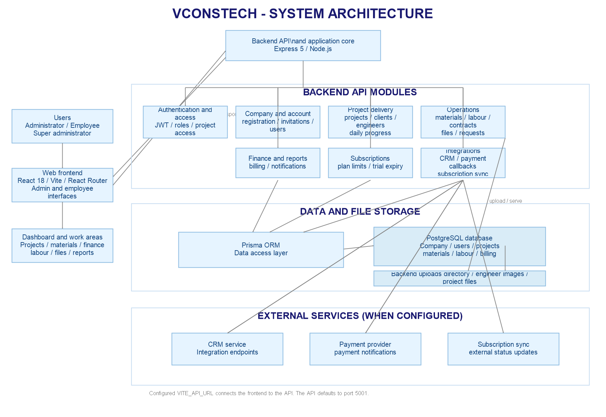
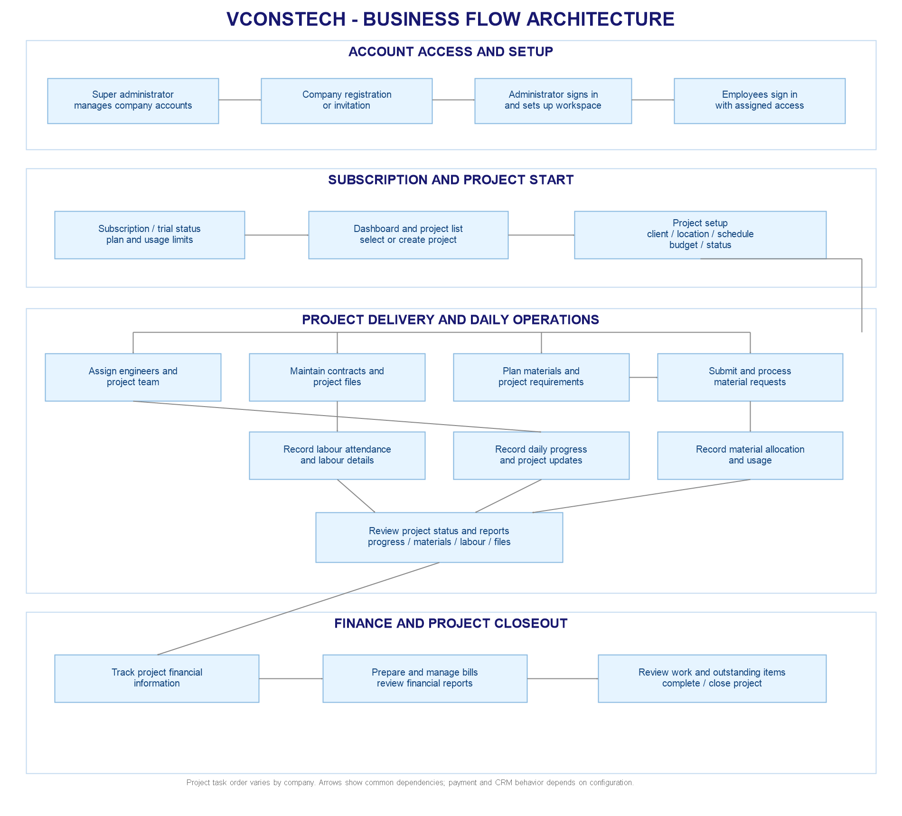
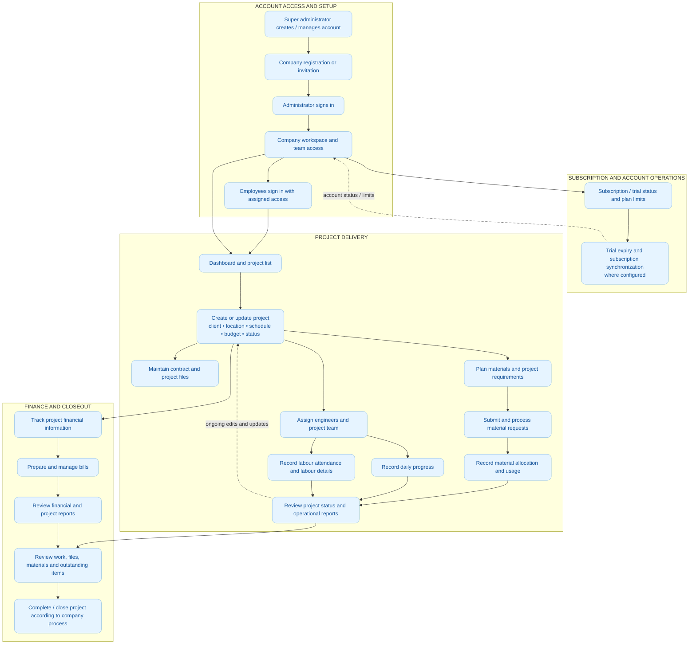

# VConstech — system and business flow architecture

These diagrams describe the application in this repository. They use the same grouped, top-to-bottom flow style as the supplied examples. External hosting, production infrastructure, and integrations depend on deployment configuration.

PNG exports: [System architecture](./VCONSTECH_SYSTEM_ARCHITECTURE.png) · [Business flow architecture](./VCONSTECH_BUSINESS_FLOW_ARCHITECTURE.png)

## System architecture

```mermaid
flowchart TB
  U[Users<br/>Administrator • Employee • Super administrator] --> WEB[React 18 + Vite web application<br/>React Router • Tailwind CSS]
  WEB -->|HTTPS / JSON API requests| API[Express 5 backend<br/>Node.js • port 5001 by default]
  WEB -->|Configured API base URL| CFG[VITE_API_URL]
  CFG -. configures .-> WEB

  subgraph BACKEND[API and application services]
    API --> AUTH[Authentication and access control<br/>JWT • role checks • project access]
    API --> CO[Company, user, invitation<br/>and registration endpoints]
    API --> PM[Project, client, engineer<br/>and daily progress endpoints]
    API --> OPS[Materials • requests • usage<br/>labour • contracts • files]
    API --> FIN[Financial management<br/>bills • reports • notifications]
    API --> SUB[Subscription and usage endpoints<br/>trial expiry scheduled job]
    API --> INT[Webhook and integration endpoints<br/>CRM • payment notifications • subscription sync]
  end

  AUTH --> PRISMA[Prisma ORM]
  CO --> PRISMA
  PM --> PRISMA
  OPS --> PRISMA
  FIN --> PRISMA
  SUB --> PRISMA
  INT --> PRISMA
  PRISMA --> DB[(PostgreSQL<br/>company and operational records)]

  OPS --> FILES[Upload handling / static file route]
  FILES --> STORE[(Backend uploads directory<br/>engineer images • project files)]
  WEB -->|Read uploaded files| FILES

  INT -. when configured .-> EXT[External services<br/>CRM • payment provider / payment callbacks]
  EXT -. webhook or sync request .-> INT
  API -->|JSON response / error| WEB
  WEB -->|Updated screens and reports| U

  classDef node fill:#e6f4ff,stroke:#8bbce5,color:#15539a,rx:12,ry:12;
  classDef store fill:#d9ecf7,stroke:#8bbce5,color:#17283b;
  class U,WEB,CFG,API,AUTH,CO,PM,OPS,FIN,SUB,INT,PRISMA,FILES,EXT node;
  class DB,STORE store;
```

## Business flow architecture

### Flow notes

- Administrators manage company projects and supporting records; employees use the areas enabled for their account. Super administrators manage company accounts.
- Project tasks can happen in different orders depending on the construction workflow. The arrows show common dependencies, not a mandatory checklist.
- Payment notifications, subscription synchronization, and CRM endpoints are present in the backend. Their live behavior depends on external service configuration.
- Uploaded engineer images and project files are served from the backend uploads directory in this repository's current implementation.
